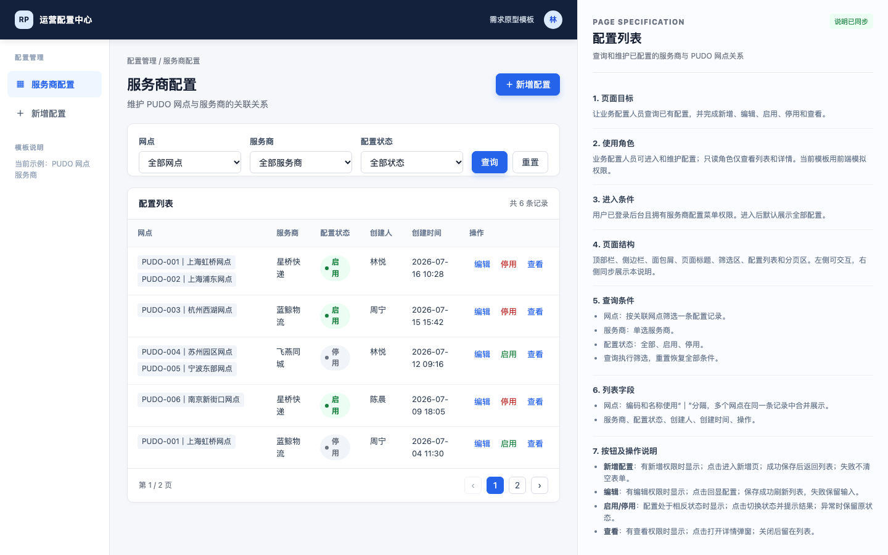
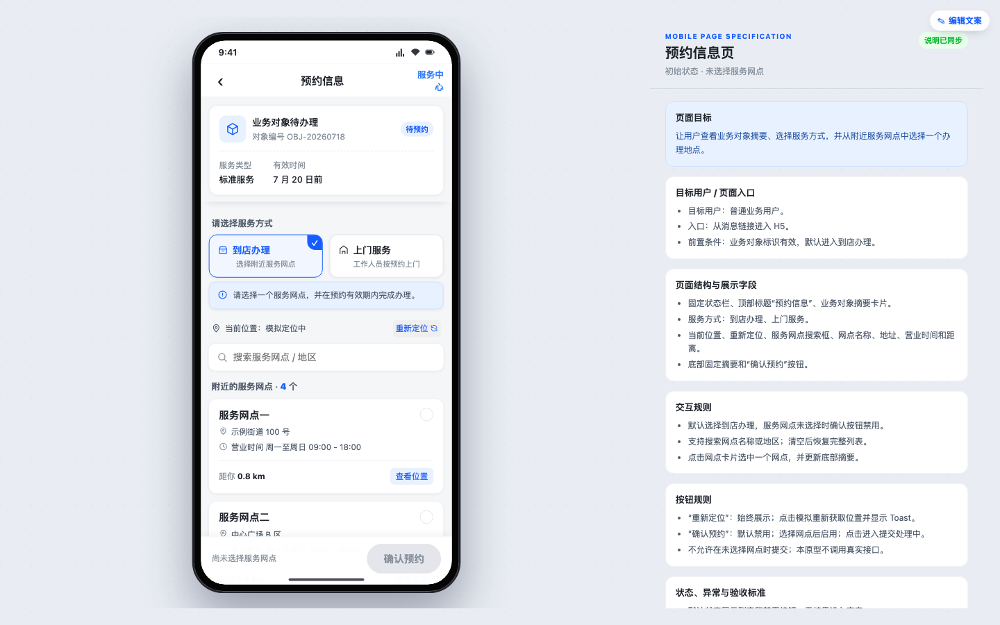

# requirement-prototype

把一句模糊的业务需求，变成 **能点的高保真原型 + 能评审的需求说明**。输出单文件 HTML，双击就能打开，直接给老板、客户和研发看。

适用对象：产品经理、需求分析师、售前，以及任何需要快速把想法变成"看得见、点得动"的东西的人。



Web 后台效果：左侧可交互原型（列表、筛选、新增、编辑、状态操作全部能点），右侧与本页同步的需求说明。



APP/H5 效果：手机外壳内独立滚动，选择、搜索、底部操作、Toast、成功页可交互，右侧说明同步切换。

## 它解决什么问题

- **原型慢**：从需求到 Axure/Figma 初稿往往要一两天，这里一句话出第一版，当面对评审。
- **说明散**：原型一个文件、需求说明一个文档、验收标准再一个文档，经常对不上。这里原型和说明强制同步在同一个页面里。
- **评审空转**：口头需求容易被理解偏。有可点的东西，分歧会立刻暴露出来。

## 30 秒上手

**1. 安装**（任选一个你使用的工具，把仓库放进对应目录）：

```bash
git clone https://github.com/<你的用户名>/requirement-prototype.git

# Claude Code
git clone https://github.com/<你的用户名>/requirement-prototype.git ~/.claude/skills/requirement-prototype

# Codex
git clone https://github.com/<你的用户名>/requirement-prototype.git ~/.codex/skills/requirement-prototype

# WorkBuddy
git clone https://github.com/<你的用户名>/requirement-prototype.git ~/.workbuddy/skills/requirement-prototype
```

也可以放到项目目录让团队共用：`<项目>/.claude/skills/` 或 `<项目>/.workbuddy/skills/`。

**2. 使用**：新开一个会话，用自然语言描述需求即可自动触发，例如：

> 帮我做一个"骑手每日考勤统计"的 Web 后台需求原型：按日期和站点筛选，列表展示出勤、迟到、异常单量，支持导出。原型和需求说明放当前目录。

需要移动端时说明"APP"或"H5"，Web 与 APP 同时存在会分别生成两个独立文件。也可以提供 PRD 文档、页面截图或现有 HTML，skill 会按其字段、风格和流程还原。

## 你会拿到什么

1. 结构化需求分析（背景、角色、场景、规则、假设、待确认事项）
2. 页面清单和核心业务流程
3. 可交互的单文件 HTML 原型（离线可用，零依赖，不依赖构建工具和 CDN）
4. 每个页面的配套需求说明（目标、字段、校验、状态、权限、异常、验收标准）
5. 交付前的自检结果

设计原则：字段、按钮、状态与需求说明完全一致；所有重要按钮有明确结果；没有业务依据的功能不会被擅自加上。

## 支持范围

| 支持 | 不支持 |
|---|---|
| Web 后台：列表、新增、编辑、详情、弹窗、抽屉、筛选分页 | 原生 APP 安装包、Flutter / RN / Swift / Kotlin 工程 |
| APP/H5：列表、表单、详情、选择、确认、成功页，手机外壳与状态预览 | 数据库设计、后端接口代码 |
| 字段校验、状态与权限规则、异常场景、验收标准 | 复杂审批流 / 工作流引擎、真实地图 / 推送 / 相机调用 |

超出范围的部分会保留在"待确认事项"中明确标记，不会被擅自扩展成复杂系统。

## 可选：接入你的设计规范

开箱即用，不依赖任何外部设计库。如果你的团队有统一视觉（Figma 文件、Axure 元件库、截图或 PDF），在 `SKILL.md` 末尾的"可选配置"里填写即可，生成的原型会尽量贴合团队既有设计语言；留空则按内置规则生成。

## 校验

```bash
python3 scripts/validate_html.py templates/prototype-template.html
python3 scripts/validate_html.py templates/app-prototype-template.html
python3 scripts/validate_html.py <你生成的原型>.html
```

需要 Python 3.9+，仅用标准库，会自动判断 Web 或 APP/H5 类型并执行对应检查。

## 目录结构

```text
requirement-prototype/
├── SKILL.md                        # 主流程：终端判断、需求分析、生成规则、自检
├── templates/
│   ├── prototype-template.html     # Web 后台评审页模板（左原型右说明）
│   └── app-prototype-template.html # APP/H5 评审页模板（手机外壳 + 说明）
├── references/
│   ├── requirement-rules.md        # 需求整理、提问边界与假设策略
│   ├── prototype-rules.md          # Web 原型布局、交互与状态规则
│   ├── app-prototype-rules.md      # APP/H5 原型规则
│   └── self-checklist.md           # 交付前自检清单
├── examples/                       # 示例需求与预期交付
├── scripts/
│   └── validate_html.py            # 离线 HTML 校验脚本
└── docs/                           # README 预览图
```

生成的原型输出到你的**当前项目目录**（默认 `./requirement-name-web.html` / `./requirement-name-app.html`），不写入 skill 安装目录。

## 在哪些工具里可用

任何支持 Agent Skills 规范（`SKILL.md` + 文件夹）的工具都可以，包括 Codex、Claude Code、WorkBuddy 等。装好后用自然语言描述需求即可触发；Codex 也可用 `$requirement-prototype` 显式调用。

## 推荐的迭代方式

```text
真实需求 → 生成原型 → 按自检清单验收 → 找到遗漏
→ 修改 SKILL.md 或 references 规则 → 重新生成
```

每次迭代只解决一类问题，并保留一个可复现的需求案例（放 `examples/`），避免修复一个案例时破坏已有页面和规则。

修改入口：

- 分析方法、提问边界、假设策略 → `references/requirement-rules.md`
- 布局、交互、状态、展示方式 → `references/prototype-rules.md` / `app-prototype-rules.md`
- 交付前检查项 → `references/self-checklist.md`
- 主流程、范围、输出约束 → `SKILL.md`
- 通用页面骨架 → `templates/*.html`

## License

MIT
